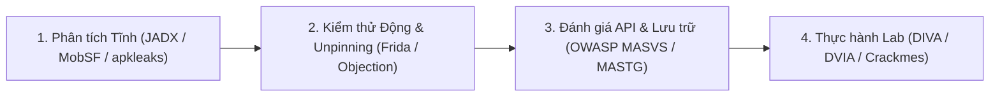

[English](README.md) | **Tiếng Việt**

# Bảo Mật Ứng Dụng Di Động (Mobile Application Security)

<strong>Bộ công cụ kiểm thử xâm nhập Android & iOS, tài liệu chuẩn OWASP MAS/MASTG, phòng lab lỗ hổng và checklist kiểm thử tải dùng ngay.</strong>

  
  
  
  
  

  <a href="#công-cụ-kiểm-thử-di-động-thiết-yếu">Công cụ</a> &nbsp;·&nbsp;
  <a href="#cheatsheet--checklist-đi-kèm">Checklists</a> &nbsp;·&nbsp;
  <a href="#android">Android</a> &nbsp;·&nbsp;
  <a href="#phòng-lab-thực-hành-android">Lab Android</a> &nbsp;·&nbsp;
  <a href="#ios">iOS</a> &nbsp;·&nbsp;
  <a href="#phòng-lab-thực-hành-ios">Lab iOS</a>

  &nbsp;&nbsp;&nbsp;&nbsp;
  

> [!TIP]
> **Tệp đính kèm sẵn trong repo:** `i0s-cheatsheet.md`, `MPTC.md` và hai file checklist Excel (`Mobile_App_Security_Checklist-English_1.2.xlsx`, `MobileApp_Checklist_2017.xlsx`).

## Mục lục

- [Công cụ Kiểm thử Di động Thiết yếu](#công-cụ-kiểm-thử-di-động-thiết-yếu)
- [Cheatsheet & Checklist đi kèm](#cheatsheet--checklist-đi-kèm)
- [Android](#android)
  - [Bài viết & Hướng dẫn Android](#bài-viết--hướng-dẫn-android)
  - [Phòng Lab thực hành Android](#phòng-lab-thực-hành-android)
  - [Công cụ & Tài nguyên khác (Android)](#công-cụ--tài-nguyên-khác-android)
- [iOS](#ios)
  - [Bài viết, Tài liệu & Hướng dẫn iOS](#bài-viết-tài-liệu--hướng-dẫn-ios)
  - [Phòng Lab thực hành iOS](#phòng-lab-thực-hành-ios)
- [Credits & References (Nguồn tham khảo & Bản quyền)](#credits--references-nguồn-tham-khảo--bản-quyền)

## Công cụ Kiểm thử Di động Thiết yếu

* [OWASP MAS (MASTG & MASVS)](https://mas.owasp.org/) - Chuẩn bảo mật và cẩm nang kiểm thử ứng dụng di động chính thức của OWASP
* [MobSF (Mobile Security Framework)](https://github.com/MobSF/Mobile-Security-Framework-MobSF) - Nền tảng phân tích tĩnh và động tự động cho APK/IPA (Android & iOS)
* [Frida](https://github.com/frida/frida) - Bộ công cụ Dynamic Instrumentation giúp hook hàm, bypass SSL Pinning và phát hiện Root/Jailbreak
* [Objection](https://github.com/sensepost/objection) - Công cụ khám phá runtime dựa trên Frida (không cần root/jailbreak thiết bị)
* [JADX](https://github.com/skylot/jadx) - Trình dịch ngược mã nguồn Dex sang Java trực quan cho ứng dụng Android APK
* [HTTP Toolkit Frida Unpinning](https://github.com/httptoolkit/frida-interception-and-unpinning) - Bộ script Frida cập nhật thường xuyên để chặn bắt HTTPS và bypass chứng chỉ SSL trên Android
* [apkleaks](https://github.com/dwisiswant0/apkleaks) - Quét tệp APK phát hiện endpoint, URI và chuỗi bí mật bị lộ

## Cheatsheet & Checklist đi kèm

* [iOS Pentesting Cheatsheet](./i0s-cheatsheet.md)
* [Mobile Penetration Testing Checklist (MPTC)](./MPTC.md)
* [Mobile App Security Checklist v1.2 (.xlsx)](./Mobile_App_Security_Checklist-English_1.2.xlsx)
* [Mobile App Checklist 2017 (.xlsx)](./MobileApp_Checklist_2017.xlsx)

## Android

### Bài viết & Hướng dẫn Android

* [Thiết lập Lab Pentest Android với Android Studio](https://pentestguy.com/android-pentesting-lab-setup-android-studio/)
* [Bypass iOS SSL Pinning bằng Frida](https://pentestguy.com/ios-ssl-pinning-bypass-using-frida/)
* [Bypass SSL Pinning bằng Frida và Objection](https://pentestguy.com/ssl-pinning-bypass-using-frida-and-objection/)
* [Hướng dẫn Jailbreak iOS 15 & thiết lập môi trường Pentest](https://pentestguy.com/how-to-jailbreak-ios-15-setup-for-pentesting/)
* [Tài liệu Bảo mật Hệ điều hành Android (AOSP)](https://source.android.com/security)
* [Mẹo Bảo mật cho Lập trình viên Android](https://developer.android.com/training/articles/security-tips)
* [OWASP Mobile Security Testing Guide (MASTG)](https://mas.owasp.org/MASTG/)
* [OWASP Mobile Security Testing Guide (Wiki lưu trữ)](https://www.owasp.org/index.php/OWASP_Mobile_Security_Testing_Guide)
* [Kiểm thử bảo mật ứng dụng Android đa nền tảng](https://3xpl01tc0d3r.blogspot.com/2019/09/security-testing-for-android-app-part1.html)
* [Phân tích chuyên sâu Bảo mật Ứng dụng Android](https://blog.0daylabs.com/2019/09/18/deep-dive-into-Android-security/)
* [Kiểm thử ứng dụng Android bằng Frida](https://www.notsosecure.com/pentesting-android-apps-using-frida/)
* [Mobile Application Penetration Testing Cheat Sheet](https://github.com/sh4hin/MobileApp-Pentest-Cheatsheet)
* [Dịch ngược Ứng dụng Android 101](https://www.evilsocket.net/2017/04/27/Android-Applications-Reversing-101/#.WQND0G3TTOM.reddit)
* [Các lỗ hổng phổ biến trên Android WebView](https://pentestlab.blog/2017/02/12/android-webview-vulnerabilities/)
* [OWASP Mobile Top 10](https://www.owasp.org/index.php/OWASP_Mobile_Top_10)
* [Pháp y số (Forensics) trên điện thoại Android](https://resources.infosecinstitute.com/practical-android-phone-forensics/)
* [Mobile Reverse Engineering Unleashed](http://www.vantagepoint.sg/blog/83-mobile-reverse-engineering-unleashed)
* [quark-engine - Hệ thống chấm điểm mã độc Android chống rối mã](https://github.com/quark-engine/quark-engine)
* [Lưu lượng mạng và ứng dụng trên Android (PDF)](https://www.sans.org/cyber-security-summit/archives/file/summit-archive-1528491463.pdf)
* [GEOST BOTNET - Khám phá trojan ngân hàng mới trên Android (PDF)](http://public.avast.com/research/VB2019-Garcia-etal.pdf)
* [Mobile Pentesting With Frida (Tài liệu chia sẻ)](https://drive.google.com/file/d/1JccmMLi6YTnyRrp_rk6vzKrUX3oXK_Yw/view)
* [Magisk Systemless Root - Phát hiện và khắc phục](https://www.mobileiron.com/en/blog/magisk-android-rooting)
* [AndrODet: Bộ phát hiện làm rối mã (obfuscation) trên Android](https://arxiv.org/pdf/1910.06192.pdf)
* [Bảo mật Mobile API thực hành](https://hackernoon.com/hands-on-mobile-api-security-get-rid-of-client-secrets-a79f111b6844)
* [Zero to Hero - Kiểm thử ứng dụng di động Android](https://nileshsapariya.blogspot.com/2016/11/zero-to-hero-mobile-application-testing.html)
* [Dùng FRIDA brute-force mã hóa FDE trên Samsung Android 8](https://github.com/Magpol/fridafde)
* [Android Malware Adventures (Slides)](https://docs.google.com/presentation/d/1pYB522E71hXrp4m3fL3E3fnAaOIboJKqpbyE5gSsOes/edit)

### Phòng Lab thực hành Android

* [DIVA (Damn Insecure and Vulnerable App)](https://github.com/payatu/diva-android)
* [SecurityShepherd](https://github.com/OWASP/SecurityShepherd)
* [Damn Vulnerable Hybrid Mobile App (DVHMA)](https://github.com/logicalhacking/DVHMA)
* [OWASP-mstg Crackmes](https://github.com/OWASP/owasp-mstg/tree/master/Crackmes)
* [VulnerableAndroidAppOracle](https://github.com/dan7800/VulnerableAndroidAppOracle)
* [Android InsecureBankv2](https://github.com/dineshshetty/Android-InsecureBankv2)
* [Purposefully Insecure and Vulnerable Android Application (PIIVA)](https://github.com/htbridge/pivaa)
* [Sieve app](https://github.com/mwrlabs/drozer/releases/download/2.3.4/sieve.apk)
* [DodoVulnerableBank](https://github.com/CSPF-Founder/DodoVulnerableBank)
* [Digitalbank](https://github.com/CyberScions/Digitalbank)
* [OWASP GoatDroid](https://github.com/jackMannino/OWASP-GoatDroid-Project)
* [AppKnox Vulnerable Application](https://github.com/appknox/vulnerable-application)
* [Vulnerable Android Application](https://github.com/Lance0312/VulnApp)
* [Hackme Bank](http://www.mcafee.com/us/downloads/free-tools/hacme-bank-android.aspx)
* [Android Security Labs](https://github.com/SecurityCompass/AndroidLabs)
* [Android-security](https://github.com/rafaeltoledo/android-security)
* [VulnDroid](https://github.com/shahenshah99/VulnDroid)

### Công cụ & Tài nguyên khác (Android)

* [Android-Reports-and-Resources](https://github.com/B3nac/Android-Reports-and-Resources/blob/master/README.md) - Tổng hợp các báo cáo Bug Bounty thực tế trên Android
* [android-security-awesome](https://github.com/ashishb/android-security-awesome) - Danh sách tài nguyên bảo mật Android nổi tiếng
* [android-device-check](https://github.com/nelenkov/android-device-check) - Bộ script kiểm tra cấu hình bảo mật thiết bị Android
* [apk-mitm](https://github.com/shroudedcode/apk-mitm) - Tự động vá tệp APK để chặn bắt lưu lượng HTTPS phục vụ kiểm thử
* [Andriller](https://github.com/den4uk/andriller) - Bộ công cụ pháp y số trích xuất dữ liệu smartphone
* [Dexofuzzy](https://www.virusbulletin.com/virusbulletin/2019/11/dexofuzzy-android-malware-similarity-clustering-method-using-opcode-sequence/) - Phương pháp phân cụm mẫu mã độc Android theo chuỗi opcode
* [Chasing the Joker (Slides)](https://docs.google.com/presentation/d/1sFGAERaNRuEORaH06MmZKeFRqpJo1ol1xFieUa1X_OA/edit#slide=id.p1)
* [Side Channel Attacks in 4G and 5G Cellular Networks (Slides)](https://i.blackhat.com/eu-19/Thursday/eu-19-Hussain-Side-Channel-Attacks-In-4G-And-5G-Cellular-Networks.pdf)
* [Shodan.io-mobile-app for Android](https://github.com/PaulSec/Shodan.io-mobile-app)

## iOS

### Bài viết, Tài liệu & Hướng dẫn iOS

* [iOS Security](https://www.cse.wustl.edu/~jain/cse571-14/ftp/ios_security/index.html)
* [Thiết lập môi trường Pentest ứng dụng iOS](https://resources.infosecinstitute.com/ios-application-security-part-1-setting-up-a-mobile-pentesting-platform/#gref)
* [Tổng hợp các lỗ hổng phổ biến trong ứng dụng iOS](https://github.com/felixgr/secure-ios-app-dev)
* [OWASP iOS Application Security Testing Cheat Sheet](https://www.owasp.org/index.php/IOS_Application_Security_Testing_Cheat_Sheet)
* [OWASP iOS Testing Guide (MASTG)](https://mas.owasp.org/MASTG/)
* [Kỹ thuật Injection vào ứng dụng iOS](https://arjunbrar.com/post/ios-application-injection)
* [Low-Hanging Apples: Tìm kiếm thông tin xác thực và khóa bí mật trong ứng dụng iOS](https://spaceraccoon.dev/low-hanging-apples-hunting-credentials-and-secrets-in-ios-apps)
* [Chuỗi bài viết về Checkra1n](https://blog.digital-forensics.it/)
* [BFU Extraction: Phân tích pháp y số iPhone bị khóa](https://blog.elcomsoft.com/2019/12/bfu-extraction-forensic-analysis-of-locked-and-disabled-iphones/)
* [HowTo-decrypt-Signal.sqlite-for-IOS](https://github.com/Magpol/HowTo-decrypt-Signal.sqlite-for-IOS)
* [Can I Jailbreak?](https://canijailbreak.com/)
* [Trích xuất mật khẩu Screen Time và ghi âm từ iCloud](https://blog.elcomsoft.com/2019/10/how-to-extract-screen-time-passcodes-and-voice-memos-from-icloud/)
* [Dịch ngược ứng dụng viết bằng Swift (PDF)](https://github.com/iOS-Reverse-Engineering-Dev/Swift-Apps-Reverse-Engineering/blob/master/Reverse%20Engineering%20Swift%20Applications.pdf)
* [Kiểm thử ứng dụng iOS với Frida](https://sensepost.com/blog/2019/mettle-your-ios-with-frida/)
* [Tiếp cận kiểm thử động iOS bằng Objection](https://blog.securelayer7.net/a-run-time-approach-for-pen-testing-ios-applications-part-ii-objection-in-action/)
* [iOS Internals vol 2 (PDF)](http://newosxbook.com/bonus/iBoot.pdf)
* [Tìm hiểu chuyên sâu về iOS Code Signing](https://blog.umangis.me/a-deep-dive-into-ios-code-signing/)
* [AirDoS: Tấn công từ chối dịch vụ thiết bị iPhone/iPad lân cận](https://kishanbagaria.com/airdos/)
* [Truy cập hệ thống tệp iPhone đã jailbreak checkra1n qua SSH](https://aboutdfir.com/jailbreaking-checkra1n-configuration/)

### Phòng Lab thực hành iOS

* [OWASP iGoat](https://www.owasp.org/index.php/OWASP_iGoat_Tool_Project)
* [Damn Vulnerable iOS App (DVIA) v2](https://github.com/prateek147/DVIA-v2)
* [Damn Vulnerable iOS App (DVIA) v1](https://github.com/prateek147/DVIA)
* [iPhoneLabs](https://github.com/SecurityCompass/iPhoneLabs)

## Credits & References (Nguồn tham khảo & Bản quyền)

- **Kho gốc (Original Repository)**: [0xSojalSec/Mobile-Application-Security](https://github.com/0xSojalSec/Mobile-Application-Security)
- **Tác giả gốc (Original Author)**: [@0xSojalSec](https://github.com/0xSojalSec)
- **Cập nhật & Việt hóa**: Tổ chức lại mục lục, loại bỏ liên kết trùng và liên kết chết, cập nhật đường dẫn OWASP MAS/MASTG mới, bổ sung bộ công cụ thực chiến (OWASP MAS, MobSF, Frida, Objection, JADX, HTTP Toolkit Frida Unpinning, apkleaks) và biên dịch phiên bản tiếng Việt ([README.md](README.md)).
- **Giấy phép (License)**: Kho gốc không đính kèm tệp `LICENSE`; toàn bộ nguồn tham khảo và tác giả gốc được giữ nguyên ghi nhận tại đây.

---

Nếu kho tài nguyên này hữu ích cho công việc của bạn, hãy tặng một ⭐ để lưu lại và giúp nhiều người biết đến hơn nhé!
